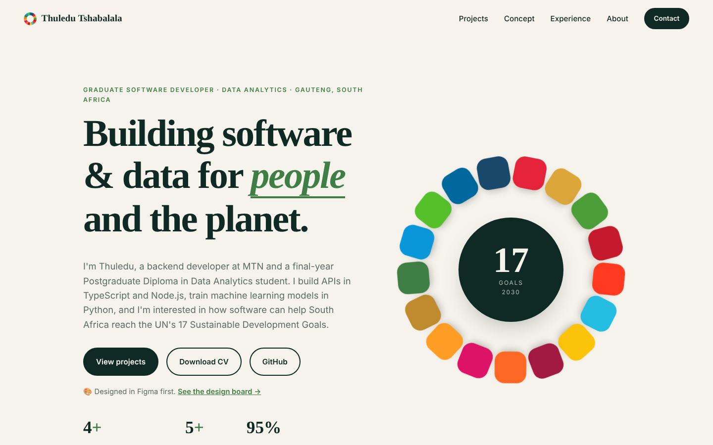
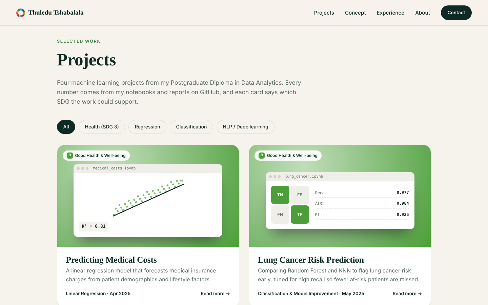
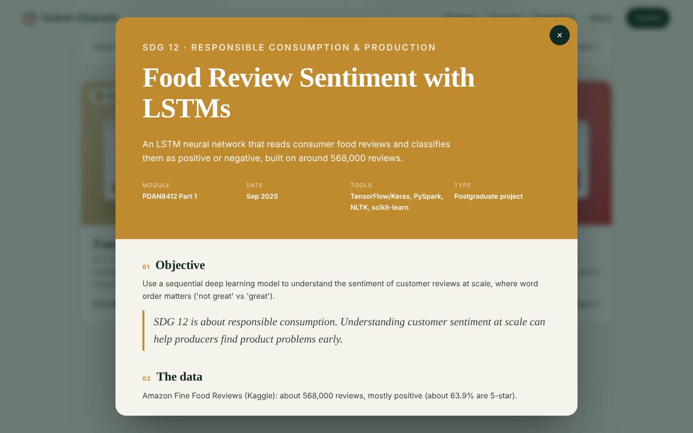

<div align="center">

# 🌍 Thuledu Tshabalala: Building for the SDGs
### Graduate Software Developer · Data and AI · UI/UX · Portfolio themed around the UN Sustainable Development Goals

**[🔗 Live site](https://thuledu.github.io/sdg-uiux-portfolio/)** · **[💼 LinkedIn](https://www.linkedin.com/in/thuledu-tshabalala-b25316228)** · **[🐙 GitHub]((https://github.com/Thuledu?tab=repositories))** · **[🎨 Figma](https://www.figma.com/files/team/1704792828215787509/recents-and-sharing/recently-viewed?fuid=1002221477123285012)** · **[🧩 Design board](https://www.figma.com/board/s6Kvc5ErpWhAEcHIoclRAa/Portfolio-%E2%80%94-SDG-Home?node-id=0-1&t=P7Biz8RZfmnKRrem-0)** · **[📄 CV](assets/Thuledu_Tshabalala_CV_BBD_UIUX.pdf)** · **[✉️ Email](mailto:thuli.tshabalala98@gmail.com)**




</div>

---

## 👋 About me

I'm **Thuledu Tshabalala**, a **Graduate Software Developer at MTN** in Gauteng, South Africa. I supported backend APIs and microservices development with **TypeScript and Node.js** in an Agile/Scrum team, and I'm in the final year of an **NQF 8 Postgraduate Diploma in Data Analytics** at The IIE Emeris (distinctions in Data Analytics 1 and Data Science).

I designed and coded this portfolio myself to bring my work together in one place. It's themed around the **UN's 17 Sustainable Development Goals** because I want my work as a developer to make a real-world difference, especially in South Africa.

---

## 🧩 Featured projects

All four are from my Postgraduate Diploma. **Every figure below comes from my own notebooks and reports** in [Postgraduate_Projects](https://github.com/Thuledu/Postgraduate_Projects).

| | Project | SDG lens | What I built | Results |
|---|---|---|---|---|
| 🩺 | **[Predicting Medical Costs](https://github.com/Thuledu/Postgraduate_Projects/tree/main/PDAN8411%20-%20Part%201%3A%20Linear%20Regression)** | 3 · Good Health | Linear regression on 1,338 medical insurance records | **R² = 0.81**; smoker status and age are the biggest cost drivers |
| 🫁 | **[Lung Cancer Risk Prediction](https://github.com/Thuledu/Postgraduate_Projects/tree/main/PDAN8411%20-%20Part%202%3A%20Classification%20and%20Model%20Improvement)** | 3 · Good Health | Random Forest vs KNN classifier, tuned for recall | **97.7% recall**, **0.984 AUC-ROC**, 87.5% accuracy |
| 🍽️ | **[Food Review Sentiment with LSTMs](https://github.com/Thuledu/Postgraduate_Projects/tree/main/PDAN8412%20-%20Part%201%3A%20Natural%20Language%20Processing%20Using%20A%20Recurrent%20Neural%20Network%20With%20LSTMs)** | 12 · Responsible Consumption | LSTM neural network in TensorFlow/Keras, with PySpark preprocessing | Processed **~568,000 reviews**; documented class-imbalance limits and next steps |
| 📚 | **[Kindle Best-Seller Prediction](https://github.com/Thuledu/Postgraduate_Projects/tree/main/PDAN8412%20-%20Part%202%3A%20Logistic%20Regression)** | 4 · Quality Education | Feature engineering plus Logistic Regression vs Random Forest vs XGBoost | XGBoost: **ROC-AUC 0.92**, **F1 0.88** |

> **What the "SDG lens" means:** these projects weren't built for the UN. The lens shows which goal each piece of work *could* support, based on the official SDG targets (e.g. target 3.4 on non-communicable diseases).



Each card opens a project page covering **Objective → SDG lens → Data → Approach → Results → Limitations & next steps**, with a link to the code.



### 💧 Work in progress: AquaPoint (SDG 6)
A **UI/UX concept** I'm designing in [Figma]((https://www.figma.com/files/team/1704792828215787509/recents-and-sharing/recently-viewed?fuid=1002221477123285012)): a simple mobile flow for reporting broken communal taps and boreholes, with icon-first reporting, offline drafts and WCAG AA contrast. It's clearly labelled on the site as a concept. User research and testing are the next steps.

---

## 💼 Experience at a glance

| Role | Organisation | Dates | SDG lens |
|---|---|---|---|
| Graduate Software Developer | MTN | Sep 2025 – Present | 9 · Industry, Innovation & Infrastructure |
| Data Analyst Graduate (Group Internal Audit) | FirstRand Corporate Centre | Jul – Aug 2025 | 16 · Strong Institutions |
| SAP Ariba Procurement Functional Analyst | Bayajula Services | Jul 2023 – Jun 2025 | 12 · Responsible Production |

**Certifications:** Microsoft Azure Fundamentals (AZ-900) · Azure Data Fundamentals (DP-900) · Carbon & ESG Analyst (University of Cambridge Online with Localized) · SQL/Business Analysis (Signature Academy) · Data Analysis Industry Training (Brainnest)

---

## 🎨 Design process

I designed this portfolio in Figma before writing any code. You can see the wireframes and layout decisions on the **[Portfolio — Home design board](https://www.figma.com/board/s6Kvc5ErpWhAEcHIoclRAa/Portfolio-%E2%80%94-SDG-Home?node-id=0-1&t=P7Biz8RZfmnKRrem-0)**. I then built it in HTML, CSS and JavaScript, keeping the spacing, colour tokens and type scale consistent with the design.

---

## ✨ Site features

- **SDG visual system:** the 17 official SDG colours as accents over a calm forest-green and paper base
- **Interactive SDG strip:** hover or tab through the goals; the ones linked to my work are highlighted automatically from the data
- **Data-driven content:** projects and experience live in plain JavaScript arrays, so adding a new project takes one object
- **Notebook-style previews built with CSS & SVG:** no image files needed for the cards
- **Accessible project pages** using the native `<dialog>` element, with previous/next navigation and **deep links** (e.g. `#case-lung-cancer`)
- **Filterable projects** (health, regression, classification, NLP) with `aria-pressed` states
- **Responsive** down to 360 px, with a mobile menu and fluid type
- **Accessibility:** semantic HTML, skip link, visible focus states, keyboard support and `prefers-reduced-motion`
- **Zero dependencies, zero build step:** open `index.html` and it works

---

## 📁 Project structure

```
sdg-uiux-portfolio/
├── index.html                     # Page structure & content
├── style.css                      # Design tokens, layout, components, animations
├── script.js                      # Project, experience & SDG data, plus interactions
├── assets/
│   ├── Thuledu_Tshabalala_CV.pdf  # Downloadable CV
│   ├── favicon.svg
│   └── preview-*.png              # Screenshots for this README
├── .nojekyll                      # Tells GitHub Pages to serve files as-is
├── LICENSE
└── README.md
```

---

## 🚀 Run it locally

**VS Code (recommended):** open the folder → install the **Live Server** extension → right-click `index.html` → **Open with Live Server**.

**Or with Python:**
```bash
git clone https://github.com/Thuledu/sdg-uiux-portfolio.git
cd sdg-uiux-portfolio
python -m http.server 8000   # then open http://localhost:8000
```

---

## 📚 Sources

- United Nations: [The 17 Goals](https://sdgs.un.org/goals)
- United Nations in South Africa: [Our work on the Sustainable Development Goals in South Africa](https://southafrica.un.org/en/sdgs)
- FairAction: [Water and the UN SDGs](https://fairaction.ngo/education-and-research/water-and-the-un-sdgs)
- Project datasets: Kaggle (Medical Cost Personal Dataset, Lung Cancer Dataset, Amazon Fine Food Reviews) and the Amazon Kindle Books Dataset 2023, credited in each project's README

The SDGs and their colours belong to the **United Nations**. This is a personal portfolio and isn't affiliated with or endorsed by the UN.

## 📄 License

Code is released under the [MIT License](LICENSE). Content and CV © Thuledu Tshabalala.

<div align="center">

**Thanks for visiting! 🌱 [Let's connect on LinkedIn](https://www.linkedin.com/in/thuledu-tshabalala-b25316228).**

</div>
